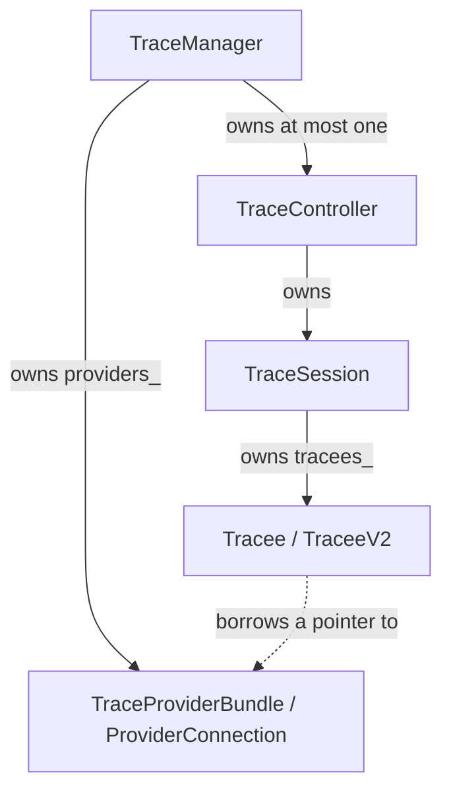
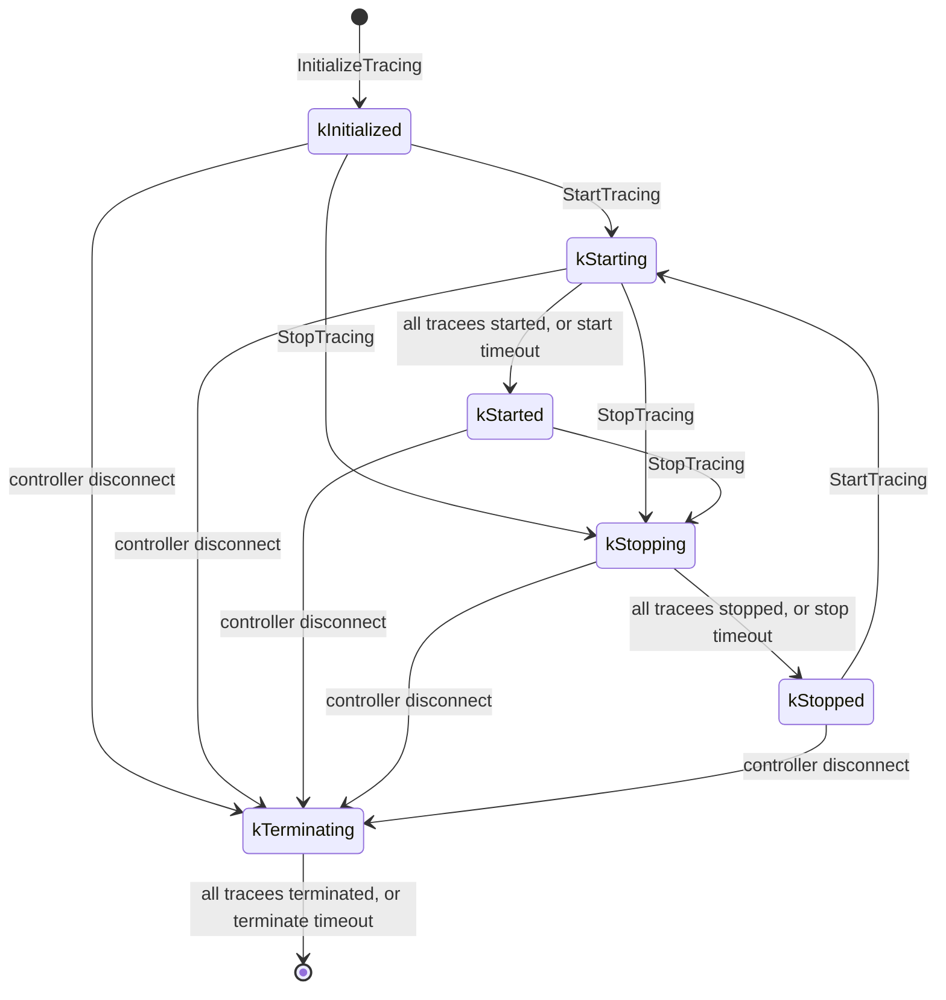
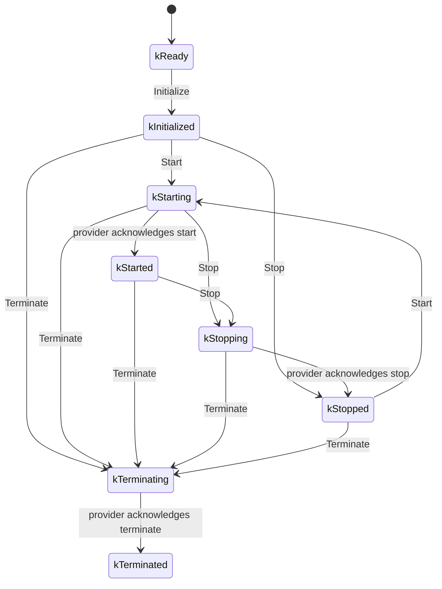

# trace_manager object lifecycle

This document describes how `trace_manager` tracks trace providers across
trace sessions: when providers are registered, when they join and leave a
session, and what happens to them when a session times out or ends. For the
overall design of Fuchsia tracing, see
[Fuchsia tracing system](/docs/concepts/kernel/tracing-system.md).

## Objects at a glance

| Object | Defined in | Lifetime | Represents |
| --- | --- | --- | --- |
| `TraceManager` | `trace_manager.h` | The `trace_manager` process | Serves `fuchsia.tracing.provider/Registry` and `fuchsia.tracing.controller/Provisioner`. Owns the provider registrations and at most one `TraceController`. |
| `TraceProviderBundle` (V1) | `trace_provider_bundle.h` | Provider registration to channel close | A registered V1 provider and its `fuchsia.tracing.provider/Provider` client. |
| `ProviderConnection` (V2) | `provider_connection.h` | Provider registration to channel close | A registered V2 provider and its `fuchsia.tracing.provider/ProviderV2` client. Also routes the provider's `OnSaveBuffer` and `OnAlert` events. |
| `TraceController` | `trace_manager.h` | `InitializeTracing` to session close | Serves one `fuchsia.tracing.controller/Session` connection and owns that session's `TraceSession`. |
| `TraceSession` | `trace_session.h` | Same as its `TraceController` | One trace session: its configuration, its state machine, the output socket (through a `BufferForwarder`), and one tracee per participating provider. |
| `Tracee` (V1) | `tracee.h` | Joins a session to leaves it | One V1 provider's participation in one session: its trace buffer and FIFO. |
| `TraceeV2` (V2) | `traceev2.h` | Joins a session to leaves it | One V2 provider's participation in one session: its trace buffer and pending FIDL calls. |

Registrations are long-lived: they belong to `TraceManager` and last as long
as the provider's channel. Tracees are short-lived: they belong to a single
`TraceSession` and never move to another session.

A tracee holds a raw pointer to its registration. When a registration goes
away, its session first removes the matching tracee (see
[Provider disconnect](#provider-disconnect)).

## Provider registration

A provider process connects to `fuchsia.tracing.provider/Registry` and calls
one of:

* V1: `RegisterProvider` or `RegisterProviderSynchronously`, handled by
  `TraceManager::RegisterProviderWorker`.
* V2: `RegisterV2` or `RegisterV2Synchronously`, handled by
  `TraceManager::RegisterProviderV2Worker`.

Each call appends a `TraceProviderBundle` or `ProviderConnection` to
`TraceManager::providers_` and assigns it a new provider id. If a session
exists, the provider is also added to it right away (see
[Joining a session](#joining-a-session)). The `*Synchronously` variants also
report whether that session has already started.

Providers built on `TraceProviderImpl` register once, when the provider is
created, usually at process startup. They do not register again. As a result,
**the registration is the only lasting link between a provider and
`trace_manager`**: anything that drops a registration removes that provider
from tracing until its process creates a new provider.

`GetProviders` and `GetKnownCategories` on `Provisioner` iterate over
`providers_`, so they see every registered provider whether or not a session
exists.

### Provider disconnect

A registration is removed only when its channel unbinds, for example because
the provider process exited or closed the channel. The unbind handler set in
`RegisterProviderWorker` or `RegisterProviderV2Worker`:

1. Calls `TraceSession::RemoveDeadProvider` or `RemoveDeadV2Provider` on the
   current session, if there is one. This runs the same path as a provider
   finishing termination: it writes the provider's results if they haven't
   been written yet and the session writes results on terminate, then removes
   the tracee from `tracees_`.
2. Erases the registration from `providers_`.

Nothing else in `trace_manager` erases a registration. In particular,
timeouts and errors within a session affect only the tracee, not the
registration.

## Sessions

A client calls `Provisioner.InitializeTracing` with a `TraceConfig`, a
`Session` server end, and an output socket. `TraceManager::InitializeTracing`:

1. Rejects the request if a `TraceController` already exists. Only one
   session can exist at a time.
2. Creates a `BufferForwarder` wrapping the output socket, or a
   `DeferredBufferForwarder` when the config sets `defer_transfer` (ignored on
   the `astro` board).
3. Creates a `TraceSession` in state `kInitialized` and writes the trace info
   records to the socket.
4. Calls `TraceSession::AddProvider` for **every** registration in
   `providers_`.
5. Wraps the session in a new `TraceController` bound to the `Session`
   channel.

### Session states

There is no `kTerminated` state. A terminated session is destroyed, and
`TraceManager` then has no session. A session can also end at any time
through `TraceSession::Abort()`, for example when writing to the output socket
fails. Abort destroys the `TraceController` and its session immediately.

A session can go through several start/stop cycles. It ends when the
controller closes its `Session` channel. `TraceManager::OnControllerDisconnect`
calls `TraceController::TerminateTracing`, which calls
`TraceSession::Terminate`. When termination finishes or times out,
`TraceManager::CloseSession` destroys the `TraceController`, its
`TraceSession`, and every remaining tracee. A new `InitializeTracing` call is
accepted only after that.

### Timeouts

| Timeout | Default | Armed by | When it fires |
| --- | --- | --- | --- |
| Start | `TraceConfig.start_timeout_milliseconds`, 5 s if unset | `TraceSession::Start` | `SessionStartTimeout` logs the tracees that haven't started and moves the session to `kStarted`. Those tracees stay in the session. |
| Stop | 60 s (`kStopTimeout`) | `TraceSession::Stop` | `SessionStopTimeout` evicts every tracee that hasn't stopped (see [Leaving a session](#leaving-a-session)), flushes the output, and moves the session to `kStopped`. |
| Terminate | 60 s (`kStopTimeout`) | `TraceSession::Terminate` | `SessionTerminateTimeout` logs the tracees that haven't terminated and runs the terminate callback, which destroys the session and all remaining tracees. |

## Tracees

### Joining a session

`TraceSession::AddProvider` creates a tracee for a registration and calls its
`Initialize`. Initialization allocates the trace buffer VMO (sized by the
session's buffer size, or by the provider's entry in
`TraceConfig.provider_specs`) and sends the provider `Initialize`:

* V1 (`Tracee::Initialize`): also creates a FIFO and starts waiting on it.
  The provider reports `STARTED`, `STOPPED`, `SAVE_BUFFER`, and `ALERT` as
  [FIFO packets](FIFO-packets.md).
* V2 (`TraceeV2::Initialize`): there is no FIFO. Start, stop, and terminate
  are acknowledged by FIDL replies, and buffer-save and alert requests arrive
  as `OnSaveBuffer` and `OnAlert` events on the `ProviderConnection`. After a
  successful `Initialize`, `AddProvider` registers callbacks on the
  `ProviderConnection` that forward those events to this tracee and session.
  Each callback checks that the tracee still exists, so events from a provider
  that has left the session are dropped.

If `Initialize` fails, the tracee is discarded and the provider does not take
part in this session. Its registration is unaffected.

A tracee joins a session only through `AddProvider`, which is called in two
places:

1. **At `InitializeTracing`**, for every registered provider.
2. **At registration**, for a provider that registers while a session exists.
   If the session is already starting or started, the new tracee is started
   immediately with a cleared buffer. If the session is stopping or stopped,
   it is marked stopped so the session doesn't wait for it.

`AddProvider` ignores new providers while the session is `kTerminating`.

### Tracee states

`Tracee` and `TraceeV2` share `Tracee::State`:

A V1 provider acknowledges start and stop with FIFO packets, and acknowledges
terminate by closing its end of the FIFO. A V2 provider acknowledges each
request by replying to the FIDL call. `Stop` on a tracee that was never
started marks it stopped without contacting the provider.

`Tracee::Start` and `TraceeV2::Start` require the tracee to be in
`kInitialized` or `kStopped`. Restarting a stopped session therefore must not
find a tracee still in `kStopping`, which is one reason the stop timeout
evicts such tracees instead of leaving them in the session.

### Writing trace data

Trace data reaches the output socket in these cases:

* When a tracee stops and the `StopTracing` request set `write_results`, the
  session writes that provider's buffer to the socket.
* When a tracee terminates, the session writes its buffer if the tracee was
  started, its results weren't already written, and the session writes
  results on terminate.
* In streaming mode, the session writes a buffer half each time the provider
  sends a buffer-save request while the tracee is starting, started,
  stopping, or terminating. If writing fails, the session terminates that
  tracee.

With a `DeferredBufferForwarder`, these writes go to a temporary file, which
is copied to the socket when all tracees have stopped (or the stop timeout
fires) and when the forwarder is destroyed.

### Leaving a session

A tracee leaves its session, and is destroyed, in exactly these cases:

| Trigger | Where | Registration |
| --- | --- | --- |
| `Initialize` fails | `TraceSession::AddProvider` | Kept |
| The provider acknowledges terminate, during session termination or after a failed buffer save | `OnProviderTerminated`, `OnV2ProviderTerminated` | Kept |
| The provider's channel unbinds | `RemoveDeadProvider`, `RemoveDeadV2Provider` | Removed |
| The tracee hasn't stopped when the stop timeout fires (eviction) | `TraceSession::SessionStopTimeout` | Kept |
| The session is destroyed | `~TraceSession` | Kept |

#### Eviction on stop timeout

When the stop timeout fires, `SessionStopTimeout` treats each tracee that
hasn't reached `kStopped` as unresponsive. For each one it:

1. Logs a warning naming the provider.
2. Sends the provider a best-effort `Terminate`, so that the provider stops
   writing to a buffer that `trace_manager` no longer reads. Nothing waits for
   the reply.
3. Removes the tracee from `tracees_`.

The session then flushes the output, moves to `kStopped`, and replies to
`StopTracing` with stats for the remaining providers only.

Eviction has these consequences:

* **The evicted provider sits out the rest of the session.** No code path adds
  a provider to an existing session except a new registration, so a later
  `StartTracing` on the same `kStopped` session starts only the remaining
  tracees.
* **Late events from the evicted provider are ignored.** The session no longer
  has a tracee to deliver V1 FIFO packets to, and V2 `OnSaveBuffer` and
  `OnAlert` callbacks drop events once the tracee is gone. Late V2 replies
  have no effect on the session (see [Pending V2 calls](#pending-v2-calls)).
* **Session termination doesn't wait for the evicted provider.** Only the
  remaining tracees need to acknowledge `Terminate`.
* **The next session includes the evicted provider again.** Its registration
  is still in `providers_`, so the next `InitializeTracing` calls
  `AddProvider` for it.

What the provider does in that next session depends on whether it has
recovered. `TraceProviderImpl` releases its engine session as soon as it
handles `Terminate`, so it accepts the next `Initialize`. If its trace engine
is still stopping from the earlier session, however,
`Session::InitializeEngine` fails. The provider then stays connected, but it
has no engine session: it replies to `Start`, `Stop`, and `Terminate`
immediately and contributes no trace data until its engine finishes stopping.

### Pending V2 calls

`TraceeV2` sends `Start`, `Stop`, and `Terminate` as two-way FIDL calls and
handles each reply with `.Then(...)`. That ties the reply handler to the
lifetime of the `ProviderConnection`'s FIDL client:

* If the client is destroyed (the registration was removed), pending reply
  handlers are discarded without being called.
* If the tracee is destroyed first, for example by eviction, the reply
  handlers still run when the replies arrive. The `Start` and `Stop` handlers
  do nothing once the tracee is gone. The `Terminate` handler still calls the
  callback it was given, which reports that the provider acknowledged
  `Terminate`. Callers must not assume the tracee still exists at that point.
  For an evicted tracee that callback does nothing.

## Source references

* [`trace_manager.cc`](/src/performance/trace_manager/trace_manager.cc):
  `TraceManager` and `TraceController`.
* [`trace_session.cc`](/src/performance/trace_manager/trace_session.cc):
  `TraceSession`.
* [`tracee.cc`](/src/performance/trace_manager/tracee.cc),
  [`traceev2.cc`](/src/performance/trace_manager/traceev2.cc): tracees.
* [`provider_connection.cc`](/src/performance/trace_manager/provider_connection.cc):
  V2 registrations and event routing.
* [`//zircon/system/ulib/trace-provider/provider_impl.cc`](/zircon/system/ulib/trace-provider/provider_impl.cc):
  the provider-side `TraceProviderImpl`.
