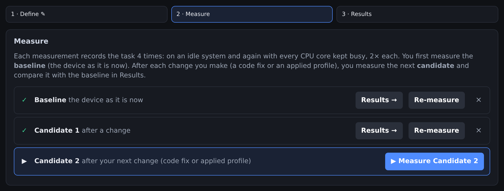
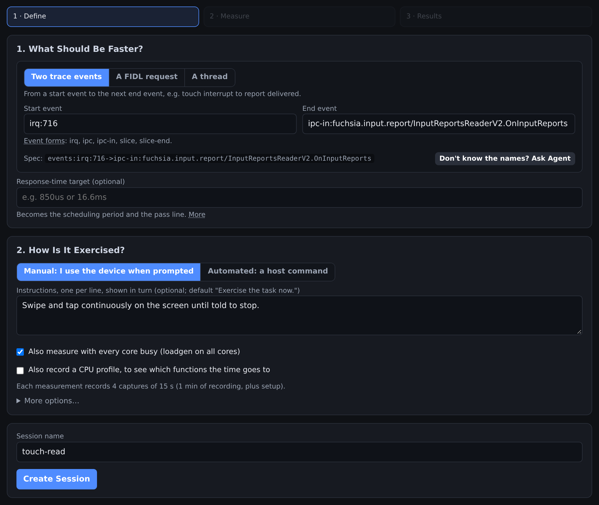
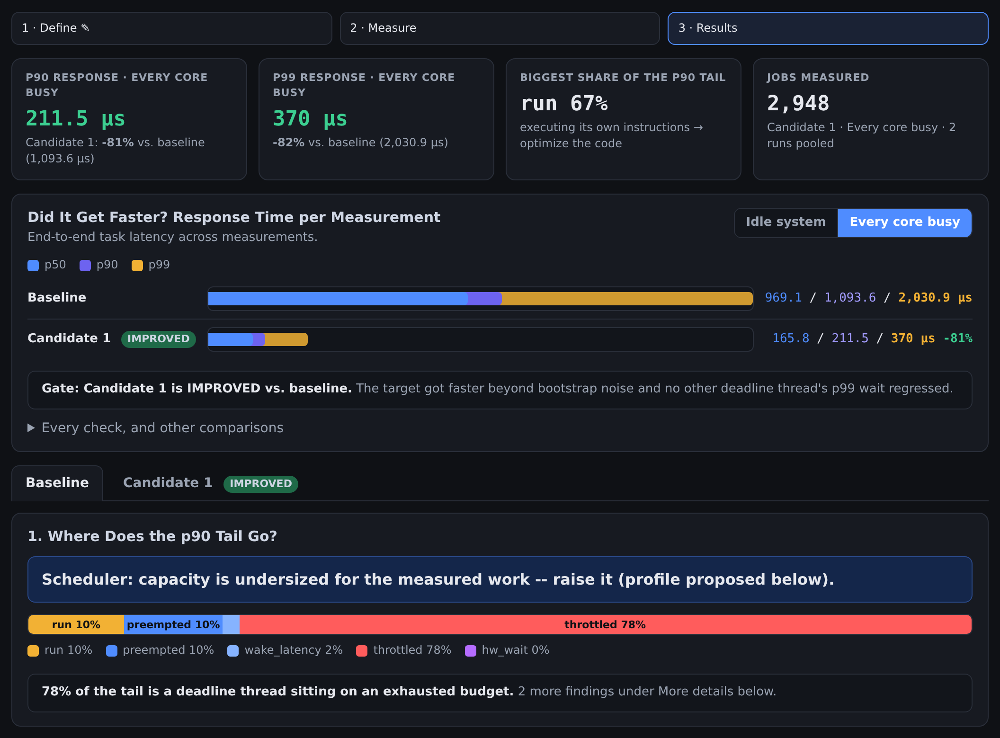
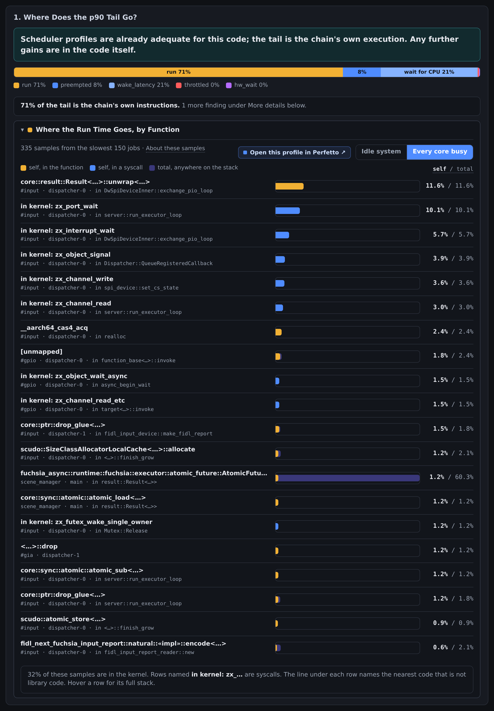
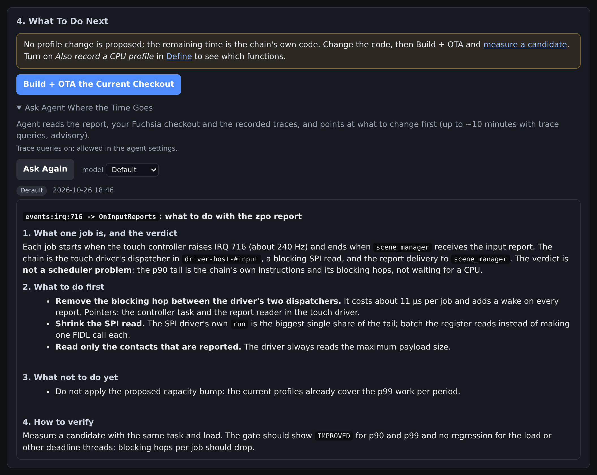
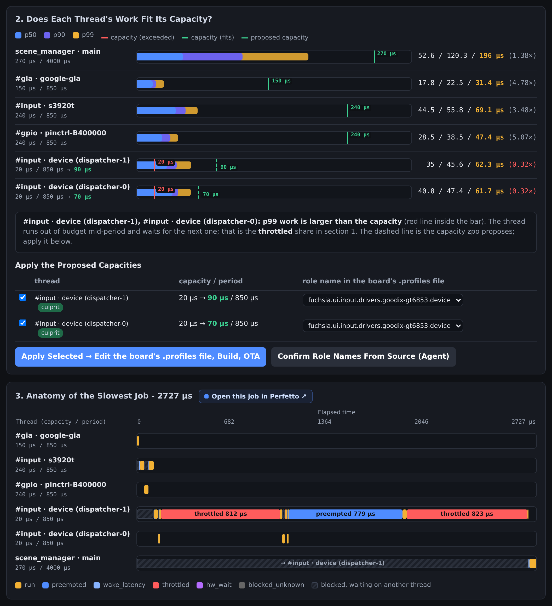
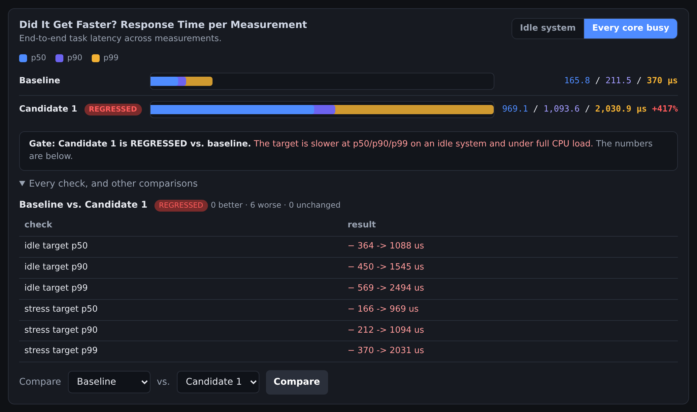
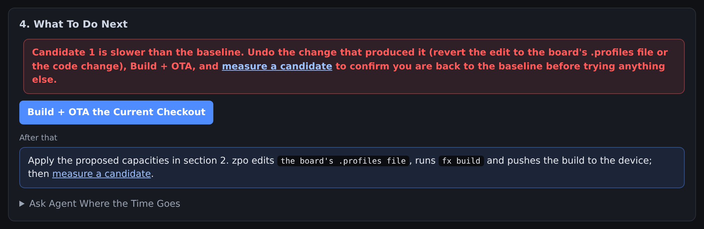

# zpo: Zircon Profile Optimizer

**What it is.** A tool that measures a task on a device running Fuchsia, tells
you *why* it is slow, and only when the answer is "the scheduler" derives
Zircon deadline-profile parameters (`capacity` / `period` / `affinity`) for the
board's `.profiles` file. It then verifies them on the device with an A/B gate
that refuses anything that regresses something else.

**What it is not.** It is not a way to make a task faster by giving it a bigger
priority number. If the task's own code, an IPC dependency, or a hardware wait
dominates, zpo says so and shows you where, and it re-derives the profile after
you fix that.

Every rule in zpo comes from a series of lessons on the Zircon scheduler. When
an extension provides a link to them (see [Extensions](#extensions)), each
finding links to the subsection that explains it.

[TOC]

## Prerequisites

1.  **A Fuchsia checkout with a build for your device.** zpo builds and
    flashes whatever `fx get-build-dir` points at, so point it at the build for
    the product on your device (`fx set …` or `fx use out/<dir>`). Measuring
    needs no build. Before building, *Build + OTA* and *Apply* warn you (and
    ask whether to go ahead) when the build directory does not look like an
    image for the board the device reports; if a build then has no product
    bundle to flash, they stop with an error that says what it builds and how
    to fix it.

    zpo takes `ffx` and `fx` from the checkout. *Apply* finds the board's
    `.profiles` file through the build directory: a Bazel query from its main
    product bundle to the roles files the board installs.
    The build installs the prebuilt trace processor (Perfetto v59 or newer)
    next to the `zpo` binary; `$ZPO_TRACE_PROCESSOR` overrides it. zpo picks
    the checkout from, in order: `--fuchsia-dir PATH`, `$FUCHSIA_DIR`, the
    current directory (or a parent of it), the checkout that the `fx` on your
    `PATH` belongs to, then `~/fuchsia`. The UI header shows which checkout it
    uses (hover it to see why).

2.  **The device reachable by `ffx`**, with RCS = Y in `ffx target list`,
    running an eng build: zpo reads the CPU performance domains from
    `cpuctl describe` and the roles from `/boot/config/profiles/`, and saves
    both with each measurement. No board file is needed. Proposals check that
    their utilization fits the chosen CPUs only when `cpuctl describe` prints
    each domain's logical core IDs; zpo warns before measuring when it does
    not.

3.  **The device on your build** (a known baseline), e.g. with `fx ota`. zpo
    checks the device's `/system/meta` merkle and its
    `/boot/config/profiles/<file>` against your checkout before and after
    every OTA, so you always know whether the device runs what you think it
    runs.

4.  **The tool:**

    ```sh
    fx set <your product> --with-host //zircon/skills/zpo
    fx build --host //zircon/skills/zpo
    $(fx get-build-dir)/host-tools/zpo ui start   # starts the UI server, prints its link
    ```

5.  **Optional: a coding agent**, for the *Explain*, *Discover* and *Confirm
    roles* buttons, through an agent backend declared by an extension.
    Everything else works without it.

### Accounts and credentials

zpo is a local tool: each person runs their own `zpo ui start` on their own machine,
and everything it does runs as the user who started it. Nothing is shared and
there are no API keys, tokens or service accounts in the source.

| what | runs as / uses |
|---|---|
| `ffx` / `fx` (tracing, loadgen, `fx build`, OTA) | your Fuchsia checkout (shown in the UI header) and your `ffx` target |
| edits to the board's `.profiles` file | a plain file edit in your checkout; you review and land it |
| Explain / Discover / Confirm roles | the agent backend an extension declares, running as you |
| sessions, traces, results | `~/.local/share/zpo/sessions` (override with `zpo ui start --sessions DIR`) |
| the UI's access token | `~/.config/zpo/ui_token` (readable only by you), made on first use; `zpo ui start --new-token` replaces it |
| the background UI server's record and log | `~/.local/state/zpo/ui_server.json` and `ui_server.log` |

## The browser UI

```sh
zpo ui start     # starts the server in the background and prints its link
zpo ui stop      # stops it (so does the red X in the UI's top bar)
zpo ui restart   # stops the running server, if any, and starts a new one like it
```

`zpo ui start` starts the server in the background and returns. The server keeps
running after the command returns and after you log out, until `zpo ui stop`
or the red X in the top bar stops it. It listens on every interface (`--host
127.0.0.1` keeps it to this machine) and prints a link like
`http://<host>:8765/#t=<token>`; open it from any machine that can reach yours.

The token after `#t=` is the only key. Browsers do not send that part of a link
over the network: the page keeps it in the browser's storage for this server's
address, removes it from the address bar and sends it in an `X-Zpo-Token`
header; the server refuses every request without it, and its log never shows
it. Anyone with the link can run commands as you on this machine, so keep it
private; `zpo ui start --new-token` makes a new one and old links stop working. If the port is not reachable from your laptop,
`ssh -L 8765:127.0.0.1:8765 <workstation>` and the printed link with
`localhost` as the host also work.

Running `zpo ui start` again while a server runs asks whether to replace it
(`--yes` replaces it without asking; `zpo ui restart` never asks). Either way
the new server keeps the old one's sessions dir, port, address and checkout,
except those you pass again, and what you pass then is kept by later
restarts too. To go back to the defaults, run `zpo ui stop` and then
`zpo ui start`. If the kept checkout is no longer a Fuchsia checkout, the new
server finds one as `zpo ui start` would and says so. Without a terminal
`zpo ui start` keeps the running server and prints its link. `--foreground` runs the server in the
terminal instead. If the page loses the server, a banner says
so and the page reconnects on its own once the server is back; a reload while
the server is down shows the page from the browser's copy, with the same banner.

The UI walks you through three steps:

| step | what you do | what zpo does |
|---|---|---|
| **1 Define** | say what should be faster: two trace events, a FIDL request or a thread (see [Naming the task](#naming-the-task)). Then say how it is exercised: *manual* (you use the device when prompted) or *automated* (a host command). Optionally give the response-time target the task must meet. Missing or malformed fields are flagged next to their label when you press *Create Session*. | saves a *session* |
| **2 Measure** | press *Measure Baseline* and follow the on-screen prompts (e.g. swipe or tap when asked). | records the task on an idle system **and** under full CPU load (`loadgen` on all cores), N repeats each |
| **3 Results** | read top to bottom. *Did It Get Faster?* shows every measurement on one scale and the comparison with the baseline. The tabs pick one measurement for sections 1 to 4: where the p90 tail goes, whether each thread's work fits its capacity, the slowest job, and what to do next. If the verdict is code or hardware: change the code, then press *Build + OTA*. If it is scheduling: under section 2, tick the proposed capacities, pick the role names and press *Apply Selected*. Then measure a candidate in step 2; the UI brings you back here. | analyzes the task along its critical path and decides: *code* / *dependency hops* / *hardware* / *scheduling* / *fine*. *Apply* edits the board's `.profiles` file in your checkout, runs `fx build`, pushes the build to the device and verifies it. Once a candidate exists, *Did It Get Faster?* compares it with the baseline and passes only if the target improved and **nothing** regressed (the target in any condition, the load's throughput, every deadline thread's p99 wait) |

Repeat Measure → Results until the comparison says "improved" and the verdict
is "fine", or the comparison says "neutral". An improved candidate is "fine"
only when its own verdict recommends no further profile change; otherwise it
keeps its own verdict and the headline starts with "Improved vs. baseline".



## Naming the task

Pick whichever you can describe. All three end up as the same thing: a list of
*jobs* (time windows) on an anchor thread.

| form | use when | example |
|---|---|---|
| `events:<start>-><end>` | you can name the user-visible latency, from a device event to its delivery. **Preferred.** Events: `irq:<n>`, `ipc:<Method>` (message sent), `ipc-in:<Method>` (message arrives), `slice:<Name>`, `slice-end:<Name>` | `events:irq:716->ipc-in:fuchsia.input.report/InputReportsReaderV2.OnInputReports` (touch IRQ → report reaches scene_manager) |
| `fidl:<lib/Protocol.Method>` | the task is "this request is slow" | `fidl:fuchsia.hardware.spi/Device.ReceiveVector` (client write → reply) |
| `thread:<process>/<thread>` | you only know the thread (globs allowed) | `thread:driver-host-#input/fdf-dispatcher-thread-3*`: jobs are the thread's wake → terminal-block epochs; blocks that wait for a reply to a message it sent do not end the epoch |

To find the names, record a short trace
(`ffx trace start --categories kernel:ipc,kernel:irq,kernel:meta --duration 5 --output t.fxt`)
and open it in https://ui.perfetto.dev, or in step 1 press *Don't know the
names? Ask …* next to the task fields if an agent backend is available. It
records 10 s while you exercise the task and fills in the fields from the
trace's FIDL methods, interrupts and busiest threads.

The **response window** (`--window`, e.g. `850us`, `16.6ms`) is the one number
that is a requirement rather than a measurement. If the consumer of the task's
output defines one (frame, audio buffer, report rate), give it: it becomes the
period and the pass line.



## Reading a verdict

Each job's time is split into buckets; the verdict is made on the **p90 tail**,
because that is what a deadline profile is bought for:

| bucket | what happened | the fix |
|---|---|---|
| `run` | the chain executed its own instructions | optimize the code; if it varies a lot between jobs, find the slow path |
| `preempted` | runnable, but another thread had the CPU | deadline profile |
| `wake_latency` | woken, waiting for a CPU | deadline profile / affinity |
| `throttled` | a deadline thread used up its capacity this period and waits for the next one, even with a CPU free (also after a sleep, if it wakes before the period ends) | raise capacity |
| `hw_wait` | blocked until an interrupt or timer | hardware or protocol change; **needs hardware-context review** |
| `blocked_unknown` | the waker is outside the trace | bigger buffer, more depth |

When the task is blocked, zpo follows the kernel's *waker* edge into the thread
that woke it (recursively), so a wait on another driver shows up as that
driver's `run` or `wake_latency`, not as a mystery. Results section 2 (work per
period against capacity, per thread on the critical path) and section 3 (the
slowest job's timeline) show that chain, and **blocking IPC hops per job** in
the full report (under *More details*) lists the hops that could be colocated
or removed.

*Open this job in Perfetto* (section 3 heading) streams that capture from your
machine into ui.perfetto.dev, zoomed to the job with its critical-path threads
pinned. Nothing is uploaded. *More details › Captures* opens any capture the
same way.



**Which functions?** When the verdict is the chain's own code, the next
question is where in the code. Tick *Also record a CPU profile* in Define and
each measurement adds one capture per condition that samples the processes on
the task's chain every 100 µs (`ffx profiler`, started before the trace so its
setup stays out). Results then include a collapsible *Where the Run Time Goes,
by Function* drawer inside section 1: the samples that fall inside the run
segments of the slowest 10 % of jobs, by leaf function (`self`), with the share
anywhere on the stack (`total`) next to it. Rows named *in kernel: zx_…* are
syscalls, with the code that made the call. Hover `self / total` for what the
two columns mean, *About these samples* for which jobs and processes were
sampled, or a row for its full stack. *Open this profile in Perfetto* streams
the profile capture of the selected condition into ui.perfetto.dev, zoomed to
its slowest job with the sampled threads pinned; samples show as markers on the
thread tracks (select one for its stack, or drag over a range for a flame
graph). The processes come from the session's latest analysis (or, for a first
baseline, from a quick look at one of its captures), so a different task
samples different processes. Sampling the very threads being measured costs
some speed, so profile captures never count toward the comparison or the gate.



The headline verdicts:

*   **Profiles adequate: the code itself dominates.** No profile change is
    proposed. *What To Do Next* offers to ask the agent where the time goes; it
    reads the report and the driver source and points at concrete changes.
    After your change, build, OTA and measure a candidate.
*   **Profiles adequate: waits on hardware.** Fewer transactions, hardware
    signalling (e.g. hardware chip-select), DMA. zpo cannot test features it
    did not exercise: list them (tap-to-wake, suspend…) and retest.
*   **Scheduler: the work waits for a CPU.** Threads on the path without a
    profile get one; apply and verify.
*   **Scheduler: capacity undersized.** Raise it; the period stays.
*   **Scheduler: contention between already-profiled threads.** Nothing to
    derive from this data; options are a shorter period (only if the window
    allows), wider affinity, or less competing deadline work.
*   **Fine.** Nothing dominates (and p99 is inside the window if you gave one).

Section 4, *What To Do Next*, turns the verdict into one instruction in a
coloured box: blue when a profile change is proposed, orange when the remaining
time is the code or the hardware, green when the task is in good shape.



How the numbers are derived (so you can argue with them):

*   **period**: your `--window`, else the shortest period already configured on
    the path (all stages aligned), else the 1st percentile of the measured
    inter-arrival (bursts merged), rounded down to 10 µs. A thread that already
    has its own, different period keeps it and is flagged.
*   **capacity**: p99 of the thread's *normalized* work per period window:
    runtime × CPU processing rate, which is what the kernel charges (from the
    trace's `kernel:power` `Rate:CPU:n` counters; zpo requires them). The capacity is the upper 95% bootstrap confidence
    bound of that p99, pooled over the repeats of the condition, rounded up to
    10 µs: it covers the sampling error of the measured p99 instead of a fixed
    margin, since a deadline thread's quota is hard. Never lower than
    the current capacity unless you pass `--allow-shrink`. When a job was
    throttled, the window is the kernel period it ran out in, with the stall
    cut out, so work from an earlier job in that same period counts too: they
    share one budget.
*   **affinity**: a thread running with the parameters of a role the device
    loaded keeps that role's CPUs; a new role gets the CPU set most of the
    device's deadline roles use. Either way, if `U = C/T` exceeds the top rate
    of the slowest of those CPUs, zpo proposes the faster domains instead
    (skipped, with a note, when the device's `cpuctl` does not report which
    CPUs are in each domain).

## Applying and verifying

When the verdict is a scheduling problem, Results section 2 ends with *Apply
the Proposed Capacities*: tick the threads, pick each role name, and press
*Apply Selected*. That edits the role's line in the board's `.profiles` file,
which the build directory names (comments preserved; new roles are appended),
runs `fx build`, pushes the
product bundle to the device through a tunneled repository server, reboots, and
checks the `/system/meta` merkle and the on-device profiles. Expect 10 to 15
minutes.

Role names are not in the trace: the UI ranks the roles the device loaded by
matching the parameters currently in effect and the thread and process names; *Confirm Role
Names From Source* asks the agent to read the driver source and confirm.
**Check the role before applying.** The change is a plain edit in your
checkout: review it and land it through the normal review when the comparison
is happy.



Once a candidate exists, *Did It Get Faster?* runs the **gate**, which compares
it with the baseline, condition by condition (idle, stress):

*   `IMPROVED`: target p50/p90/p99 better beyond bootstrap noise and by at
    least 5% in every baseline/candidate capture pair, nothing worse.
*   `NEUTRAL`: no significant change either way (what you get from a harmless
    edit).
*   `REGRESSED`: something got worse: the target in some condition, the number
    of jobs the load produced (throughput), or the p99 runnable wait of any
    deadline thread in the system (threads that run under a deadline profile
    most of the time; a fair thread briefly boosted by priority inheritance does
    not count). The callout says what got worse in one sentence, *Every check*
    lists the numbers, and *What To Do Next* starts with "undo the change"
    before any other advice.





## Command line

Everything the UI does is also a command (`zpo <cmd> --help`):

```sh
zpo analyze --trace t.fxt --task "events:irq:716->ipc-in:…OnInputReports" [--window 850us] [--out report.md] [--dump-job -1]
zpo session-init --session ~/zpo/touch --task "…" --load-mode manual --instruction "Swipe for 15s" [--repeats 2] [--no-stress] [--profile]
zpo measure      --session ~/zpo/touch --name baseline   # prints the verdict and proposals
zpo profile-apply --session ~/zpo/touch --name baseline [--role LABEL=ROLE …] [--all] [--dry-run]
zpo profile-set  --role <role> --capacity 150us --period 850us [--dry-run]
zpo ota                                           # fx build + push + verify
zpo measure      --session ~/zpo/touch --name candidate-1
zpo session-analyze --session ~/zpo/touch --name candidate-1   # re-run the analysis
zpo gate         --session ~/zpo/touch --candidate candidate-1
zpo roles        --analysis out.json [--topology measurement.json]   # role-name suggestions
zpo explain      --report report.md               # agent narrative + fix suggestions
zpo report       --format html -o results.html [--session DIR …] [--first NAME]
zpo ui start     [--yes] [--foreground] [--port 8765]   # background UI server; prints its link
zpo ui restart
zpo ui stop
```

**For agents and scripts:** `zpo ui start` leaves a background server running
after it returns; run `zpo ui stop` when you are done. A later `zpo ui start`
finds the running server and, without a terminal, reuses it and prints its link
instead of asking (`--yes` or `zpo ui restart` replaces it with the same
settings).

`--dump-job -1` prints the slowest job's segment-by-segment timeline, which is
the fastest way to *see* the chain.

`measure` and `session-analyze` write the same `summary.json` the UI shows and
print its verdict and proposals. `profile-apply` writes a measurement's
recommended proposals (with the top suggested role unless `--role` names one)
through the same merge as the UI's *Apply Selected*: threads sharing a role get
the largest capacity, the shortest period and the union of their CPUs. Without
CPUs (`profile-set` without `--affinity`), an existing role keeps its own and
a new one gets the set most of the device's deadline roles use. Both first
check that the build directory is for the device, as *Apply* does, and stop
otherwise (`--yes` edits anyway).

## Sharing results

`zpo report --format html` writes saved sessions into one self-contained HTML
file that works without a server or a device: the UI's results pages with the
data inlined, and the actions that need a device or an agent disabled. Use it
to attach an investigation to a bug or a review. In the UI, *Download Report*
in the top bar saves the open session's report, once the session has an
analyzed measurement.

## Extensions

An optional agent backend and optional lesson links come from extension
directories, searched in order:

1.  the directories in `$ZPO_EXTENSIONS` (colon-separated),
2.  `$FUCHSIA_DIR/vendor/*/tools/zpo/`,
3.  zpo's own directory, `$FUCHSIA_DIR/zircon/skills/zpo/`.

An **agent backend** is declared in the extension's `zpo_extension.json`:

```json
{ "agent": { "name": "MyAgent", "command": "zpo-myagent" } }
```

zpo runs `<command> <verb>` with a JSON request on stdin and reads a JSON reply
from stdout; see [`src/agent.rs`](src/agent.rs) for the verbs (`info`,
`models`, `ask`, `query-access`).

**Lesson links**, also in `zpo_extension.json`, point each finding's "why"
link at a document that explains the rule behind it:

```json
{
  "lessons": {
    "url": "https://example.com/scheduler-lessons.html",
    "anchors": {"throttled": "#quota", "capacity": "#demand", "hops": "#head-of-line"}
  }
}
```

The topics are `own_work`, `period`, `scheduling`, `capacity`, `throttled`,
`hardware`, `affinity` and `hops` (see `LESSON_TOPICS` in
[`src/extensions.rs`](src/extensions.rs)). Without lesson links, findings have
no "why" link.

## Troubleshooting

| symptom | cause / fix |
|---|---|
| "This page does not have the zpo server's token" | the page was opened without the token, or the token changed (`zpo ui start --new-token`). Open the link `zpo ui start` prints; running `zpo ui start` again prints it. |
| "Lost the connection to zpo on …" | the server stopped (`zpo ui stop`, the red X, or the machine restarted) or the network dropped. Run `zpo ui start` on that machine; the page reconnects on its own. |
| `port 8765 is in use by another program` | pick another port: `zpo ui start --port <other>`. |
| `no jobs found for …` | the task did not run during the capture: screen off or locked, load not exercised, or wrong names. Check with a 5 s `ffx trace` and Perfetto, or use Discover. |
| capture is short / "providers dropped records" | the trace buffer is too small for the duration. Raise *Trace buffer (MB)* in the session (512 MB handles about 20 s of full-system tracing). |
| OTA fails | the error shows ffx's own reason, with its full output folded underneath. If the build directory does not look like an image for the board, that is the likely cause (see [Prerequisites](#prerequisites)). Otherwise the device usually could not fetch from the package server zpo started on your host: check that `ffx target list` still shows the device (and `ffx log --filter system-updater` when ffx suggests it) and retry. zpo always verifies the merkle **and** the on-device profiles afterwards, so a failed OTA never goes unnoticed. |
| "Nothing to flash" after a build | the build directory has no product bundle with an update repository, i.e. it builds another product. Point the checkout at the device's build (`fx use out/<dir>` or `fx set …`) and retry. |
| Explain / Discover / Confirm roles fail | the agent backend is not available for your user; the error shows its reason. |
| device still shows an old commit date after OTA | `build-info` on some products does not track your checkout; trust the merkle check (`zpo ota` prints it). |
| `zpo needs trace processor v59 or newer` | update the checkout and rebuild zpo; warm sessions need `server unix`. |
| `no trace processor at …` | rebuild zpo (`fx build //zircon/skills/zpo`), which installs it next to the binary. |
| note: `the trace has no kernel:power Rate:CPU counters` | Zircon writes a rate counter only when a CPU changes operating point, so a capture where every CPU stayed at one (or one recorded without the `kernel:power` category) has none. zpo then charges each CPU at its domain's top rate, which can only overstate work. |
| "CPU fit checks unavailable" before measuring, or the note "CPU fit not checked" on proposals | the device's image has a `cpuctl` from before it printed which CPUs are in each domain, or its CPU driver does not report real core IDs (zpo uses them only when they are distinct and number the CPUs 0 to N-1). Measuring and the proposed capacities work as usual; only the check that a proposal's utilization fits its CPUs is skipped. Sync your checkout and put a newer image on the device to enable it. |
| big `blocked_unknown` share | the waker was outside the trace or the chain is deeper than `--max-depth 6`; increase the depth or the buffer. |
| the verdict says "scheduling" but proposals are "unchanged" | the waiting threads already have adequate profiles: it is contention or placement, not a missing contract (see [Reading a verdict](#reading-a-verdict)). |

## Caveats

*   zpo measures performance, not correctness. A hardware or protocol change
    that passes the gate can still break a feature the load did not exercise
    (this happened with hardware chip-select and tap-to-wake). The report flags
    such recommendations; retest those features yourself.
*   Zircon today has `capacity / period / deadline / affinity` and fair
    priorities. Criticality tiers and weighted surplus sharing are not
    implemented and are never proposed.
*   `fidl:` jobs end at the first server-to-client wake (reply instants are not
    in `kernel:ipc`); one-way protocols fall back to the server's handling run.
*   A `--window` is applied per stage; across *k* chained stages the end-to-end
    guarantee is weaker than one stage's (noted in the report).
*   Agent output (Explain / Discover / Confirm roles) is advisory. Every number
    in the verdict is measured.
*   The CPU profile samples every 100 µs, which gives a few samples per job.
    The function table is a ranking over many jobs, not a per-job timeline.
    Frames without symbols show as `[unmapped]`.

## For developers

```sh
fx set <product> --with-host //zircon/skills/zpo --with-test //zircon/skills/zpo:tests
fx test //zircon/skills/zpo:lib_test        # unit tests
fx test //zircon/skills/zpo:e2e_test        # end-to-end tests (real trace processor)
```

```
src/
  main.rs           command line (`zpo <cmd>`)
  checkout.rs       finds the Fuchsia checkout
  extensions.rs     extension directories: agent backend, lesson links
  topology.rs       CPU domains and loaded roles, read from the device
  tp/               trace processor: warm sessions, chunked-JSON queries, every SQL query
  trace_db.rs       lazy trace loader
  model.rs          data model
  tasks.rs          task specs -> jobs
  attribution.rs    recursive critical-path attribution (the buckets)
  analysis.rs       jobs -> per-thread breakdown, hops, hardware waits
  derive.rs         capacity / period / affinity
  verdict.rs        code-vs-scheduler decision
  report.rs         text / markdown report
  stats.rs          quantiles, bootstrap confidence intervals for the gate
  cpu_profile.rs    CPU profile captures and the function table
  profiles_file.rs  edits .profiles files, preserving comments
  roles.rs          thread -> role suggestions
  device.rs         ffx/fx: trace, stress, build, tunneled OTA + verification
  runner.rs         sessions, measurements, regression gate
  summary.rs        a measurement's summary for the UI
  agent.rs          agent backend protocol; llm.rs: what zpo asks it
  server.rs         the UI's HTTP server; report_html.rs: static HTML report
  ui_daemon.rs      `zpo ui start|stop|restart`: token, state file, background server
ui/index.html       the browser UI (embedded in the binary)
ui/sw.js            keeps a copy of the page for reloads while the server is down
tests/              end-to-end tests on a generated trace (fxt_writer.rs)
docs/               the screenshots in this README
```

The trace processor is the prebuilt `trace_processor_shell`, fetched by the
build and installed next to `zpo` as `zpo_trace_processor_shell`. zpo loads
each capture once into a warm `server unix` session and runs every query with
`query --remote`, wrapped so that SQLite returns the rows as JSON in chunks of
100,000 rows (one RPC message is capped at 64 MiB). If the command line ever
proves too limited, `tp/client.rs` is the one place to switch to the shell's
`server stdio` RPC.

The screenshots in `docs/` show the real UI, rendered by headless Chrome at 2×
scale, on example sessions with a generic device and agent.
